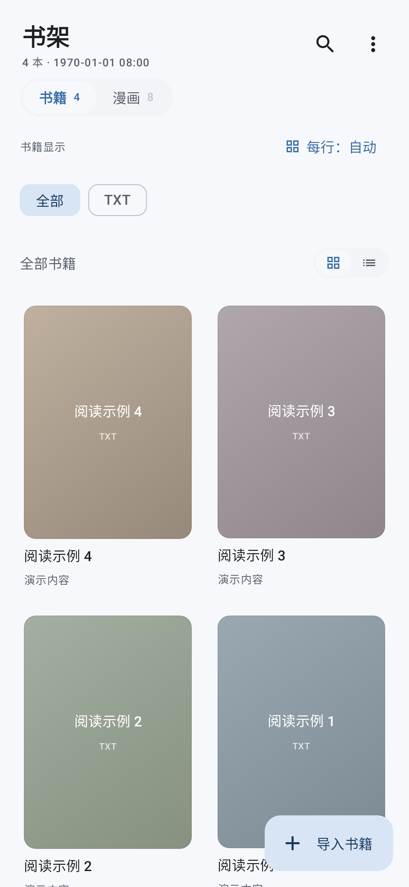
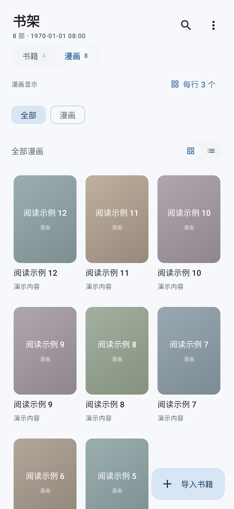
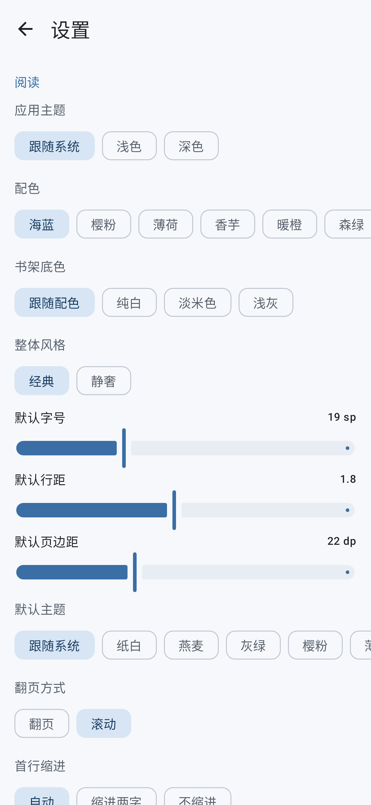
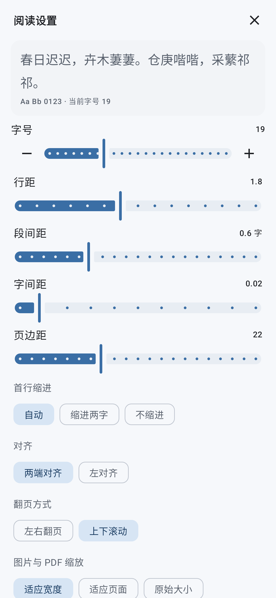

# 轻读 LightReader

一个面向 Android 手机和平板的本地多格式阅读器。文字书籍、PDF、图片与漫画包使用同一套书架和阅读数据管理；无需账号，应用不申请网络权限。

**版本：2.9.0 · Android 8.0+ · Kotlin / Jetpack Compose · 源码公开，软件免费分发**

> 允许使用、修改和免费分享，包括企业免费使用；禁止对原版或修改版收费下载、激活、订阅使用或付费解锁。修改版不强制公开源码。完整条款见 [LICENSE](LICENSE)。这是自定义免费分发许可，非 OSI 标准开源许可。第三方组件、字体和角色素材分别遵守其原有许可或权利声明。

## 开发方式

维护者通过提出需求、反馈使用问题和要求多轮修改推进项目。**应用业务代码由 AI 生成和修改，维护者未手工编写代码。** 部分图形、测试和文档也由 AI 工具生成或整理。第三方库、字体及素材仍属于各自权利人。

项目许可仅覆盖维护者或贡献者依法有权许可的部分；不能据此推定全部 AI 输出归维护者独占。详见 [AI 开发方式与许可边界](docs/AI_DEVELOPMENT.md)。发布步骤见 [公开发布指南](公开发布指南.md)。

## 功能

- **两套书架**：书籍和漫画分别管理，网格/列表、排序、格式筛选、搜索、长按操作。可将 PDF、图片等条目移到漫画书架，按连续流阅读。
- **手机显示密度**：网格支持自动或每行 2～6 个，书籍与漫画分别记忆；漫画默认 3 列。
- **文字排版**：连续滚动或分页；字体、字号、行距、段落间距、字间距、对齐、缩进和边距可调。
- **固定版式**：PDF/图片保留原始版面，支持缩放和双页模式；漫画书架使用竖向连续流。
- **阅读辅助**：目录、搜索、书签和阅读位置保存。文字章节需要明确翻页/拖动手势后进入下一章。
- **外观**：深浅色、多套主色与阅读纸色、底色选项、经典/静奢图标风格，保留嘉然限定角色装饰主题。
- **字体**：内置 Noto Serif SC，支持导入自己的字体文件。
- **数据迁移**：导出/导入 JSON 阅读数据，包含进度、书签及设置；不包含书籍本体和自定义字体文件。
- **性能处理**：设置按需布局、滑杆松手提交、面板动画避免逐帧重组整个阅读页，漫画后台读图与采样解码。

## 格式支持

| 格式 | 阅读方式 | 主要限制 |
| --- | --- | --- |
| EPUB | 重排版文字与本地插图、目录 | 不支持 DRM；复杂排版可能与原书不同，竖排暂按横排处理 |
| TXT | 编码识别、自动章节、重排版 | 自动分章依赖标题规则 |
| DOCX | 段落、常见文字样式、图片与表格 | 不完整还原 Word 页面；不支持全部公式、批注、浮动对象 |
| RTF | 文字与基础格式 | 不完整支持图片、表格 |
| HTML / XHTML | 本地正文与部分样式 | 不加载远程资源；不作为通用网页浏览器 |
| Markdown | 正文与 GFM 表格 | 不是完整 GitHub 页面渲染器 |
| PDF | 原版面、目录与文字层搜索 | 扫描件无 OCR；加密 PDF 不在支持范围 |
| 图片 | JPG/PNG/WebP/BMP/GIF 等 | 解码能力随 Android 版本而异，GIF 不保证动画播放 |
| CBZ / ZIP | 图片自然排序、按目录分章、漫画连续流 | 不支持 CBR/RAR；非漫画 ZIP 可能无法识别 |

**尚未支持**：旧版 DOC、MOBI/AZW3、CBR、DjVu、OCR、TTS、云书架和在线书源。

## 安装与使用

已发布安装包从 [GitHub Releases](https://github.com/Dianakkcc/LightReader_ai/releases) 获取。2.9.0 起使用专用发布证书；此前 Android Debug 签名用户请先读 [迁移说明](docs/MIGRATION.md)，完成数据导出后再更换安装。校验值及证书指纹随每个版本提供。

仓库内附有 `.github/workflows/android.yml`，上传后应检查 Actions 是否真正执行成功。工作流配置和本地构建成功不能代替远程 CI 结果；CI 的 unsigned APK 需要签名后才能安装。

1. 导入：书架导入按钮选择文件，也可从文件管理器的“打开方式”或“分享”进入。
2. 调密度：切换到书籍或漫画书架，点“每行数量”，选择自动或 2～6；仅网格模式生效。
3. 阅读：点条目打开，呼出工具栏后可进入目录、搜索、书签和阅读设置。
4. 字体：设置中的字体管理可预览、导入与设为默认；字体文件的使用授权由导入者确认。
5. 备份：换机前导出阅读数据，保留原书；新设备先导入相同书籍，再恢复 JSON。详见 [使用指南](docs/USER_GUIDE.md)。

移除书架记录与删除原文件是不同操作。导入保留原文件 URI，部分格式为随机访问会建立私有缓存副本；移动原文件或撤销授权后可能需要重新导入。

## 自行构建

建议使用支持 AGP 8.10.1 的 Android Studio（Meerkat Feature Drop 2024.3.2 或更高兼容版本），安装 Android SDK Platform 36 与 Build Tools 35.0.0，Gradle JDK 选 **JDK 17**。项目自带 Gradle 8.11.1 Wrapper，不需要本机另装 Gradle。

Android Studio 打开仓库根目录并完成同步；命令行需要正确配置 `JAVA_HOME` 和 Android SDK（`ANDROID_HOME` 或本地 `local.properties`）。首次构建需要下载依赖，构建完成后的 App 可离线阅读。本版 compileSdk / targetSdk 已升至36；本轮验收针对本地构建与GitHub侧载，未实际提交Google Play。

```powershell
# Windows，在仓库根目录执行
.\gradlew.bat :app:assembleDebug
.\gradlew.bat :app:testDebugUnitTest
.\gradlew.bat :app:assembleRelease
```

```bash
# Linux / macOS
chmod +x gradlew
./gradlew :app:assembleDebug :app:testDebugUnitTest :app:assembleRelease
```

Debug APK：`app/build/outputs/apk/debug/app-debug.apk`。
Release 默认不签名：`app/build/outputs/apk/release/app-release-unsigned.apk`。
发布签名通过环境变量配置，不提交密钥，见 [构建与发布](docs/BUILDING.md)。

## 项目结构

```text
app/src/main/java/com/lightreader/
  core/model/      文档、设置与书架模型
  core/format/     EPUB/PDF/TXT/DOCX/RTF/HTML/Markdown/图片/漫画解析器
  core/data/       Room、DataStore、文件工作区与备份
  core/util/       编码、图片采样、字体、路径等工具
  ui/library/     书架界面与状态
  ui/reader/      WebView 阅读引擎、固定版面、漫画流和附加面板
  ui/settings/    设置、字体管理与离线许可查看
  ui/theme/       配色和图标
app/src/main/assets/  字体、主题图片、许可全文
app/src/test/         JVM / Robolectric / Rhino 测试
app/src/androidTest/  设备界面测试
tools/preview/        真实 Blink 排版验证脚本
```

## 测试与性能证据

```powershell
.\gradlew.bat :app:testDebugUnitTest
.\gradlew.bat :app:connectedDebugAndroidTest
```

设备测试需要连接测试用手机或可用模拟器，测试工具可能安装/卸载测试应用，请使用独立测试环境。
历史 2.8.0 的 106 项本地测试通过；本轮 2.9.0 的测试、lint 和设备验证边界见 [验证记录](docs/VALIDATION.md)。
测试覆盖解析、备份、漫画跳转、列数保存及面板组合行为；这不等于所有手机上的流畅性保证。真实 Blink 验证台也不能替代 Android WebView 和手机帧时间测量。详见 [性能说明](docs/PERF-REPORT.md)。

## 隐私与安全

应用没有 `INTERNET` 权限，不主动上传书籍、阅读数据或遥测。书架数据库、设置、缓存与字体保存在应用私有空间。
但 Android 系统备份/换机迁移已启用；用户选择的文件提供程序也可能是网盘。系统或提供程序的网络行为受其自身设置控制，不能表述为“数据绝不会离开设备”。详见 [隐私说明](docs/PRIVACY.md)。

仅打开可信来源的文档；本项目未承诺防御所有恶意文档、超大压缩包或损坏文件。漏洞报告见 [SECURITY.md](SECURITY.md)。

## 许可、素材与致谢

- 本项目原创部分：[免费分发许可](LICENSE)，允许修改和免费分发，禁止给软件收费。
- 第三方库和全部解析到的 release/测试传递依赖：[THIRD_PARTY_LICENSES.md](THIRD_PARTY_LICENSES.md)、[依赖清单](docs/DEPENDENCIES.md)。
- Apache/MIT/BSD/MPL/EPL/OFL 等上游全文与 NOTICE：[licenses/](licenses/)，APK 的“设置 → 关于 → 许可与声明”也可离线查看运行时相关许可。
- 字体、角色图片及自绘图标：[素材来源与权利声明](docs/ASSETS.md)。

嘉然主题角色及装饰图片权利归原作者/相关权利人，来源链及未核实的授权状态已单独说明，不声明为项目原创，也不受项目代码许可重新授权。
**如有侵权，请通过本仓库 Issues 联系删除；我们将核实并及时处理。** 此联系说明不构成权利人的授权。

感谢 AndroidX / Jetpack Compose、Kotlin、jsoup、commonmark-java、PDFBox-Android、Bouncy Castle、Noto CJK、Liberation Fonts，以及测试框架的开发者。

## 开发与贡献

欢迎提交问题、修复和文档。请先阅读 [CONTRIBUTING.md](CONTRIBUTING.md)，并确认愿意按本项目许可提供贡献。

| 文档 | 内容 |
| --- | --- |
| [使用指南](docs/USER_GUIDE.md) | 导入、密度、阅读、备份与常见问题 |
| [构建与发布](docs/BUILDING.md) | 环境、测试、签名、CI 和 Release |
| [架构](docs/ARCHITECTURE.md) | 分层、数据流、桥接、线程和扩展点 |
| [代码规范](docs/CODE_STYLE.md) | 命名、协程、Compose 和评审约定 |
| [新增格式](docs/FORMATS.md) | 解析器接入与漫画范例 |
| [实现说明](docs/IMPLEMENTATION_NOTES.md) | 当前实现约束和容易回归的细节 |
| [更新记录](CHANGELOG.md) | 版本变化 |
| [许可说明](docs/LICENSING.md) | 免费条件、第三方例外、分发要求 |

## 发布与维护

- [旧版数据迁移](docs/MIGRATION.md)
- [2.9.0 发布说明](RELEASE_NOTES_2.9.0.md)
- [本轮审查逐项处理](docs/RELEASE_AUDIT.md)
- [发布核对步骤](docs/RELEASE_CHECKLIST.md)

仓库 topics 建议：`android`、`kotlin`、`epub-reader`、`pdf-reader`、`offline`、`comic-reader`、`jetpack-compose`。About 与 Release 内容属于仓库设置，需要维护者实际保存后才生效。

## 界面预览

以下为本版实际Compose组件在测试环境中的渲染，使用合成书架，非手机截图；[环境说明](docs/screenshots/README.md)。





